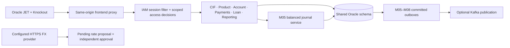

# Integration design and changes

## Architecture

The modules now form a modular monolith: one Spring application, one JDBC transaction manager, one session authority and one frontend origin. JDBC was retained because the supplied modules already encode Oracle constraints and immutable accounting semantics in explicit SQL. Replacing those repositories with an unrelated JPA schema would have weakened compatibility.

## Consolidation

The source manifest records 289 imported Java files from the supplied module code. Package boundaries were preserved. Duplicate application entry points, incompatible security configurations, independent peer HTTP clients and the original publication relay were excluded from the assembled application. A fully qualified bean-name generator avoids same-name controller and service collisions. Module exception handlers are package-scoped.

The original schema has 166 module tables. The additive statement revision table, seven banking extension tables and account override approval table bring the local fixture to **175 tables and 206 foreign keys**. No Oracle table or foreign key is renamed to fit a frontend.

| Domain | Packages / owned data | Connected API roots |
| --- | --- | --- |
| IAM | `iam`, M01 | `/api/v1/auth`, `/api/v1/iam` |
| CIF/KYC | `cif`, M02 | `/api/v1/cif` |
| Product | `product`, M03 | `/api/v1/products` |
| Accounts | `account`, M04 | `/api/v1/accounts` |
| Transactions | `txn`, M05 | `/api/v1/transactions`, `/journals`, `/fees`, `/gl`, `/reconciliation` |
| Payments | `payments`, M06 | `/api/v1/payments`, `/clearing-batches`, `/reconciliation-exceptions`, `/approvals`, `/dispatches` |
| Treasury | `treasury`, M07 | `/api/v1/treasury` |
| Loans | `loan`, M08 | `/api/v1/loans` |
| Privacy | `privacy`, M09 | `/api/v1/privacy` |
| Statements | `statements`, M10 | `/api/v1/reporting` |
| Added workflows | `integration`, MBX | `/api/v1/banking`, `/teller`, `/beneficiaries`, `/fx`, `/currencies`, `/customer-access` |

Consult the running OpenAPI document for exact methods, bodies and status codes; roots in this table are orientation, not a substitute for the contract.

## Identity and financial-detail access

All modules use M01 bearer sessions. Compatibility aliases translate existing permission names into the authorities expected by imported modules; an authenticated session alone grants no banking authority. Account access checks branch, product, currency and current CIF links. Customer ownership is verified against active account parties. Separate maker/checker identities and approval authorities apply to controlled operations. Direct journal and rail orchestration endpoints are restricted to service identities.

Customer creation issues a random 256-bit base64url account-holder key. Only its SHA-256 digest is stored, under an M01 user foreign key. The plaintext is returned once; rotation invalidates the prior value. Signed-in customers can view financial details for their own active linked accounts without this key. Authorized officers send it in `X-Customer-Hash`; the browser keeps it only in memory and clears it at logout. It supplements officer authentication and authorization. It is not a public customer identifier or password.

A response advice covers transaction/payment reads and write receipts. The list serializer was normalized after testing found that typed lists could otherwise fail when identifier-only maps replaced full records. Account balances, positions, statement generation and downloads also enforce detail access. Financial access produces audit events. Global operational totals and non-transaction contract/configuration data have their own role checks; hash gating is not a universal substitute for institution-wide field-classification policies.

## Ledger and account integration

Account controls apply synchronously through the M05 posting fence and M04 acknowledgement inside a shared transaction. A freeze is effective before the API reports completion. Available balances are read from M05 positions, not editable account projection fields.

Account opening and activation enforce the pinned product version's minor, joint-holder, maximum-holder, opening-funding and nominee terms. Adoption checks an existing account's holders and nominees against the target version before changing its pin. Pending customer accounts can add a required nominee before activation; products without a nominee requirement allow the list to be cleared. Activation retries reuse the recorded control. Module 4 validates inbound financial events against its own ordered projection, which can lag the live M05 position, while account balance reads continue to use M05.

The demo customer-opening switch governs new self-service account openings. Customers can still activate accounts they already opened and manage their own sole-operated accounts when new openings are disabled.

Transfers lock the source for velocity checks and rely on sorted ledger position locks for posting. They validate product rules, funds and directional fences, then insert balanced immutable journal lines. Canonical request hashes detect conflicting idempotency replays. Daily limits count reversed original transfers as usage. Backdated immediate transfers are rejected to prevent bypassing current-day limits.

Module 5 re-reads the pinned product version after acquiring the source account lock, so a concurrent Module 4 version adoption cannot leave transfer limits on the old terms. Account controls serialize on the Module 4 account row before their inbox check; payment holds serialize on the Module 5 position and recheck both hold key and payment ownership. Concurrent journal posting-key retries return the committed journal when the request body matches. Immediate journal posting and period-close requests reject future business dates, and close-request retries verify the original date, reason, and maker.

The same checker can safely retry an identical reversal or period-close decision after a response is lost. Concurrent period-close and fee-assessment requests resolve against the committed request key; a reused key with changed details conflicts. A different decision or checker conflicts with the recorded result. Business-date checks use the application clock in the Asia/Kolkata zone.

Product Master can approve a replacement while the current version is still active. Activation and reactivation reject overlapping active offers. Existing accounts keep their retired version's payment and internal-transfer terms until an approved treatment moves them; suspension of either the product or version blocks payment initiation and internal transfers. Direction rules use `DEBIT`, `CREDIT`, and `BOTH` for outbound and inbound payments and for the source and destination of internal transfers. Conditional rules require a policy adapter and fail closed. Customer offer responses include sale terms needed by the account, loan, and deposit screens, without internal override or transaction-control rules. Eligibility previews check the requested loan or fixed deposit amount and tenure; an omitted account opening amount means zero.

Teller deposits/withdrawals, fee collection, simulated payment debits/refunds/settlements and loan disbursements/accruals/repayments call the same balanced journal service. Balance projections are updated in the posting transaction. Corrections use explicit reversal workflows rather than editing history.

Teller cash and simulated payment authorization use the account's product version after locking the account. Simulated payment settlement and refund clear the exact customer-liability and suspense GL accounts recorded on the provisional debit journal, even if the account adopts a newer product version before the outcome arrives.

Account override approval is stored against account, product version, exact command digest, maker, nominated checker and a 24-hour expiry. Independent IAM amount/rate authority is checked before approval. The original maker applies the unchanged command; changed payloads and stale product versions fail. Consuming approval and changing the account occur in the same transaction.

## Payments and loans

The payment simulator connects beneficiary ownership, separate authorization, liquidity reservation, customer holds, suspense debit, dispatch evidence and final reserve settlement. Outcomes are explicit operations; unknown outcomes do not silently release funds. This is not a live UPI/RBI adapter. Original clearing-batch, retry and exception APIs remain available, but automated net-cycle scheduling and remote delivery need deployment adapters.

Module 6 now checks a supplied liquidity hold before HELD and its committed state before dispatch. Dispatch inquiries require a sent or uncertain message, and final payments reject further attempts. Outbound SETTLED requires a balanced settlement journal linked to the same verified Module 7 reserve entry. Reconciliation matches only final payments with scoped rail evidence, the original customer and suspense posting, the settlement journal and reserve movement, and any linked cycle. A clearing batch can link only to a ready cycle containing the same payment items; it cannot become settled while one of its payments remains pending. The local demo explicitly configures its SUSPENSE GL for reconciliation. The independent checker decision is available at `/api/v1/approvals/{id}/decision` in both the backend gate and frontend catalog.

An identical simulated initiation retry reads the original execution date and checks the submitted details against the stored request hash before returning the existing instruction. New instructions still require an active beneficiary; a reused key with different payment details conflicts. The simulation request key is capped at 92 characters because its derived correlation ID must fit the Module 6 schema.

Loan servicing is deliberately bounded to fixed-rate, monthly, single-disbursement, reducing-balance contracts. Schedules use equal principal, interest on the outstanding balance and supported day-count conventions. Accrual posts due installment interest; repayment allocates oldest due interest before principal. Unsupported fee/penalty allocations and early prepayment fail explicitly. No daily floating-rate engine is implied.

## Frontend contract

`frontend/app.js` owns the shell and Oracle JET CoreRouter. `banking.js` defines workspace routes and renders workflow forms from OpenAPI; `jet.js` binds values through Knockout and Oracle JET input components. `api.js` normalizes wrapped and unwrapped responses, attaches session/hash headers and handles downloads. The Node server serves an explicit asset allowlist and proxies only API/documentation paths to the configured backend.

Frontend amounts and long IDs are submitted as validated strings so browser floating-point conversion does not alter them. Nested optional commands, repeatable journal lines, JSON extension fields, generated request keys and `If-Match` headers are supported. Backend validation and authorization remain authoritative. Not every workflow has a bespoke guided wizard; operations workspaces expose the real domain commands.

## References

The maker/checker and modular banking concepts were compared with [Apache Fineract documentation](https://fineract.apache.org/docs/legacy/). No Fineract API compatibility is claimed. Navigation and AMD loading follow the [Oracle JET SPA guidance](https://docs.oracle.com/en/middleware/developer-tools/jet/12/develop/design-single-page-applications-using-oracle-jet.html) and [RequireJS integration guidance](https://docs.oracle.com/en/middleware/developer-tools/jet/10/develop/oracle-jet-and-requirejs.html). The installed JET version is pinned in the package lock.
