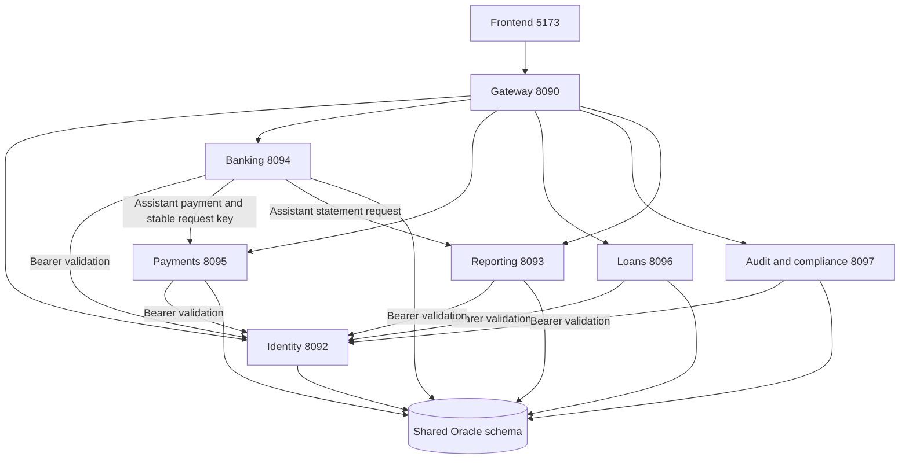

# Moneybags service architecture

The backend has **six independently packaged services** and **seven reusable domain libraries**, organized in a 16-module Maven reactor. Identity, payments, loan origination/servicing, audit/compliance and reporting have separate processes and API ownership. Banking owns customer/product/account operations, direct ledger operations, treasury, cards, deposits and the assistant, with those domains organized into named libraries. `acceptance-tests` composes the domains only for regression testing; it does not produce a deployable monolith.

## Services and API ownership

| Service | Port | Directory | Public API ownership |
| --- | ---: | --- | --- |
| Identity | 8092 | `backend/identity-service` | `/api/v1/auth`, `/api/v1/iam`, `/api/v1/customer-access`: login, sessions, refresh, MFA, user and access administration |
| Banking | 8094 | `backend/banking-service` | Customers/KYC, products, accounts, transactions, journals, reconciliation, treasury/teller, cards, deposits, FX, beneficiaries and assistant; customer inquiry views under `/api/v1/banking` |
| Payments | 8095 | `backend/payments-service` | `/api/v1/payments`, clearing batches, payment approvals, dispatches and reconciliation exceptions: instruction creation, validation, holds, dispatch, settlement and simulated refunds |
| Loans | 8096 | `backend/loan-service` | `/api/v1/loans`: application, underwriting, independent sanction, offer/acceptance, document verification, facility conversion, disbursement, schedules, accrual and repayment |
| Audit and compliance | 8097 | `backend/audit-service` | `/api/v1/privacy` and `/api/v1/internal/privacy`: financial/security/domain audit inquiry, consent, purpose/policy administration, legal holds, cases and evidence exports |
| Reporting | 8093 | `backend/reporting-service` | `/api/v1/reporting`, `/api/v1/catalog`: statement requests, issue, immutable snapshots, downloads, masking, narration and delivery policies |

The frontend remains on 5173 and proxies to the API gateway on 8090. The gateway routes every existing public URL to its owner, streams security headers and bodies, merges all six OpenAPI specifications, and checks all six readiness endpoints. Local H2 uses port 9095; no local database process starts in Oracle mode. All launcher-owned listeners bind to loopback.



## Domain libraries

| Module | Responsibility | Runtime use |
| --- | --- | --- |
| `customer-module` | CIF records, current customer facts, KYC, relationships and customer lifecycle | Banking exposes its APIs; payments and loans use its customer-facts interface |
| `product-module` | Product versions, rules, eligibility, approvals and effective commercial terms | Banking exposes its APIs; loans and deposits use the product-definitions interface |
| `account-module` | Opening, activation, ownership, parties/nominees, closure, overrides and inbound projections | Banking |
| `ledger-module` | Transaction contracts, posting fences, holds, balanced journals, exact-money positions, reversal/reconciliation logic and financial response redaction | Banking, payments and loans; card and deposit libraries |
| `treasury-module` | Reserves, liquidity holds, settlement evidence and confirmed reserve movements | Banking exposes treasury APIs; payments performs atomic liquidity operations |
| `cards-module` | Card products/applications, independent approval, controls, purchases, refunds, billing and repayment | Banking |
| `deposit-module` | Savings interest, fixed-deposit funding/maturity and fee collection | Banking |

The remaining modules are `shared`, `local-database` and `acceptance-tests`. `shared` holds wire DTOs, schema mappings, common security/error handling, permission checks and typed HTTP clients. It still contains the legacy database-backed IAM authorization and customer access lifecycle support required by existing cross-domain transactions. Domain libraries are normal JARs; services have separate `*-1.0.0-exec.jar` executables. Runtime services do not depend on another service's implementation JAR.

## Identity boundary

Identity owns the M01 authentication and administration workflows. Every downstream service forwards the original bearer token to identity's authenticated `/api/v1/auth/me`. Caller-supplied identity headers are not trusted. A rejected session returns 401; an unavailable identity dependency returns 503. Permissions, role validity, relationship validity, customer ownership and required authentication strength continue to be checked against the current database state.

Signup and customer lifecycle still touch both IAM and CIF tables in the shared schema. This coupling is explicit; separate processes do not imply separate database ownership.

## Payment and loan posting boundaries

Payments owns M06 instruction/dispatch/clearing workflows. Loan service owns M08 applications, decisions, offers, facilities and servicing. Both reuse `ledger-module` to post M05 journals **inside their own local database transaction**. Payments also uses `treasury-module` for reserve operations in that transaction. A failed authorization or posting rolls back instruction changes, holds, positions, journals and related evidence together. The services do not make an HTTP call to another ledger process in the middle of a financial transaction.

The assistant uses `PaymentInitiationPort`; deployed banking binds it to `HttpPaymentClient`. Payments independently validates the caller and request. The original intent/request key is reused across network failure and confirmation retries. Payment creation and the banking intent acknowledgment are separate transactions: a lost reply leaves the intent retryable, and payment idempotency returns the existing instruction. Concurrent confirmation and outage/recovery tests verify this boundary. Initiation creates an instruction; authorization and settlement are subsequent steps.

Beneficiary/FX administration and aggregate banking inquiry views remain banking APIs. Their source records can be read by payment workflows through the shared schema. The service table above distinguishes those APIs from payment execution.

## Audit boundary

Audit/compliance owns the M09 privacy and evidence workflows and the financial audit inquiry over immutable M05 posting history. It has its own process, readiness and gateway routes; reporting owns M10 statements independently.

IAM and financial domains write their own audit/outbox evidence within the transaction that changes the domain. Audit reads are centralized without moving those evidence writes to a remote HTTP call that could lose transaction atomicity. The authenticated domain-event inbox remains `/api/v1/internal/privacy/domain-events`, now routed to audit. Kafka is optional and remains disabled unless configured.

## Database boundary and remaining coupling

This remains a **shared-schema service extraction**. Oracle tables, foreign keys, cross-domain read models and installation keys are retained. Reporting reads posted ledger data; authorization and privacy decisions read current shared facts. A database outage affects every service. Separate Oracle schemas or databases would require ownership-specific database roles, explicit events/outbox consumers, replacement read models, and compensation/reconciliation designs before removing existing cross-domain transactions and foreign keys.

H2 fixtures remain in regression sources; the application launcher requires Oracle. Oracle startup uses `oracle-microservices` with SQL initialization disabled and never runs the local seed.

## Start and stop

Use PowerShell 7 in `Downloads/integrated`. The three user-facing scripts are:

```powershell
./set-openrouter-key.ps1
./start-alpha-team.ps1
./stop-oracle-alpha.ps1
```

The start script prompts for the encrypted ALPHA team passphrase, loads the original Oracle connection and installation keys, automatically displays all seven team logins in the console, and calls the internal Oracle lifecycle module in `tools/oracle-runtime.psm1`. It validates all ports, prerequisites, and source/artifact fingerprints; starts banking, identity, payments, loans, audit, reporting, gateway, and frontend; waits for readiness; and cleans up a partial failure. Every Java service uses `oracle-microservices` with SQL initialization disabled. The gateway remains on 8091 and frontend on 5174.

The launcher records each PID with its creation time, serializes startup/shutdown with an OS lock, and restores the parent environment. Shutdown uses the ownership record in reverse order and refuses to stop a reused PID. It can also stop a recorded run from an older launcher. No database process, database volume, or installation key is removed.

Use `-BackendPort` and `-FrontendPort` for alternate gateway/frontend ports. Internal domain service ports remain 8092–8097. Logs are `.runtime/<component>.log` and `.runtime/<component>.err.log`; ownership is `.runtime/microservices-processes.json`.

For builds before connecting a restrictive VPN:

```powershell
./start-alpha-team.ps1 -BuildOnly
# Connect the ALPHA VPN.
./start-alpha-team.ps1 -SkipBuild
```

Add `-Offline` to build with cached dependencies. `-ShowCredentials` displays saved team logins without restarting. H2 and alternate Oracle launcher scripts have been removed; H2 fixtures remain only in development/regression sources.

## Verification

```powershell
./start-alpha-team.ps1 -BuildOnly -Offline
./tools/test-oracle-startup.ps1
./tools/test-oracle-environment.ps1 -SkipBuild
```

Build verification runs the backend regression suite, HTTP client failure/retry tests, architecture/dependency checks, gateway tests, frontend tests, and standalone frontend build. The launcher suite checks preflight, partial startup cleanup, Oracle service arguments, process ownership, encrypted settings, and environment restoration without connecting to a database. The opt-in Oracle suite requires the ALPHA network and team passphrase; it checks the schema and credentials, starts all six services without H2, checks API ownership/security, and performs the financial audit in a rollback-only transaction.

The earlier local H2 environment runners were removed with the H2 launchers. Their existing [test report](MICROSERVICES-TEST-REPORT.md), [case inventory](MICROSERVICES-TEST-CASES.csv), and [structured results](MICROSERVICES-TEST-RESULTS.json) remain historical evidence. Tests do not grant permanent shared roles, reset shared passwords, or repair Oracle financial balances.
